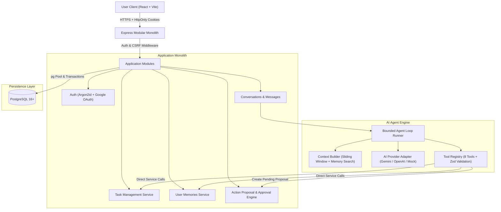
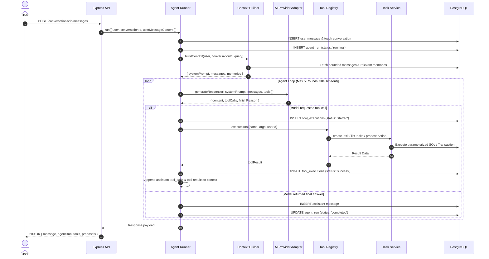

# Agentra — Architecture & Engineering Specification

## 1. System Overview

Agentra is a production-grade Personal AI Productivity Agent built as a modular monolith in Node.js (pure JavaScript ES Modules) and PostgreSQL. It delivers conversational task planning, persistent memory, and safe multi-step tool execution.

---

## 2. Component Boundaries & Responsibilities

| Component | Directory | Responsibilities |
|---|---|---|
| **Routes** | `src/modules/*/` & `src/routes/` | HTTP paths, middleware attachment (rate limit, auth). |
| **Controllers** | `src/modules/*/*-controller.js` | Parses HTTP requests, validates with Zod, sets cookies, formats JSON. |
| **Services** | `src/modules/*/*-service.js` | Business logic, state transitions, domain invariants. |
| **Repositories** | `src/modules/*/*-repository.js` | Parameterized SQL queries, pagination, count queries. |
| **Context Builder** | `src/ai/context-builder.js` | Bounded sliding window, keyword memory retrieval, untrusted context block injection. |
| **Agent Runner** | `src/ai/agent-runner.js` | Enforces bounded loops (`AGENT_MAX_ROUNDS`), timeouts, audit logging of tool executions. |
| **Tool Registry** | `src/ai/tool-registry.js` | Defines tools, Zod argument schemas, exports Gemini/OpenAI formats, executes via services. |
| **AI Provider** | `src/ai/provider.js` | Isolates external LLM SDKs behind a unified interface (`Gemini`, `OpenAI`, `Mock`). |

---

## 3. The Bounded Agent Execution Sequence

---

## 4. Action Proposals & Sensitive Execution Workflows

To prevent unauthorized or hallucinated bulk modifications:
1. When asked to schedule a multi-task plan, the agent invokes `propose_action`.
2. A pending record is written to `action_proposals` with a 24-hour expiration.
3. The frontend renders an interactive **Action Proposal Card**.
4. The user inspects the proposed schedule and clicks **Approve Plan**.
5. The backend validates proposal ownership, verifies pending and non-expired status, and executes the tasks atomically in a database transaction (`withTransaction`).
6. The proposal transitions to `executed`. Duplicate submissions return a 409 Conflict.
