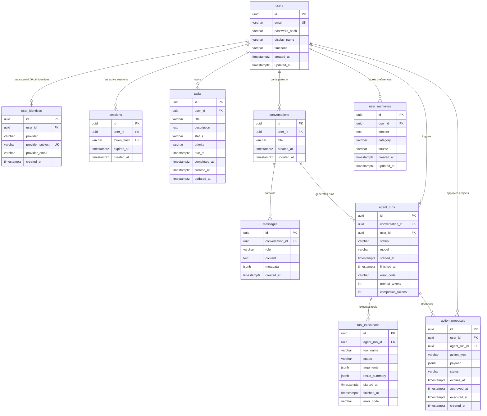

# Agentra — Database Entity-Relationship Diagram (ERD)

## 1. Relational Schema Architecture

The database is built on PostgreSQL 16+ using versioned SQL migrations (`server/migrations/`).
All identifiers use `UUID PRIMARY KEY DEFAULT gen_random_uuid()` to prevent enumeration attacks and support distributed architectures.

---

## 2. Performance Indexes & Integrity Constraints

1. **Email Normalization:**
   `CREATE UNIQUE INDEX uq_users_email_lower ON users (LOWER(email));`
2. **Session Hash Lookup:**
   `CREATE INDEX idx_sessions_user_id ON sessions (user_id);`
   `CREATE INDEX idx_sessions_expires_at ON sessions (expires_at);`
3. **Task Filters & Sorting:**
   `CREATE INDEX idx_tasks_user_status ON tasks (user_id, status);`
   `CREATE INDEX idx_tasks_user_priority ON tasks (user_id, priority);`
   `CREATE INDEX idx_tasks_user_due_at ON tasks (user_id, due_at);`
   `CREATE INDEX idx_tasks_user_created_at ON tasks (user_id, created_at DESC);`
4. **Chat & Message Pagination:**
   `CREATE INDEX idx_conversations_user_updated ON conversations (user_id, updated_at DESC);`
   `CREATE INDEX idx_messages_conversation_created ON messages (conversation_id, created_at ASC);`
5. **Memory Search:**
   `CREATE INDEX idx_user_memories_user_id ON user_memories (user_id);`
   `CREATE INDEX idx_user_memories_category ON user_memories (user_id, category);`
6. **Audit Logs:**
   `CREATE INDEX idx_agent_runs_conversation ON agent_runs (conversation_id);`
   `CREATE INDEX idx_tool_executions_agent_run ON tool_executions (agent_run_id);`
   `CREATE INDEX idx_action_proposals_user_status ON action_proposals (user_id, status);`
